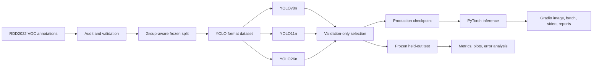

# RoadGuard AI

### Intelligent Road Damage Detection & Infrastructure Inspection Platform

[](https://github.com/fariskishtah/roadguard-ai/actions/workflows/ci.yml)
[](LICENSE)
[](pyproject.toml)

RoadGuard AI is an end-to-end computer-vision platform that finds and localizes road damage with real bounding boxes. It is owned by **Faris Mohamed Kishtah** and developed as Sprint 2 Project 2 of the INSTANT AI & Data Science Training program.

> **Evidence policy:** no benchmark number, detection screenshot, or deployment claim is published until its checkpoint, metric artifact, and verification record exist. See [PROJECT_STATUS.md](PROJECT_STATUS.md) for the live evidence ledger.

## What the detector recognizes

| Class ID | RDD2022 code | Damage category |
|---:|---|---|
| 0 | D00 | Longitudinal Crack |
| 1 | D10 | Transverse Crack |
| 2 | D20 | Alligator Crack |
| 3 | D40 | Pothole |

Predictions support multiple objects and classes in one image and return class IDs, official codes, human-readable labels, confidence scores, and original-image `xyxy` coordinates.

## Application capabilities

- Single-image inspection with original/annotated comparison.
- Confidence and NMS IoU controls with clear semantics.
- Per-detection table, class counts, average confidence, and measured inference time.
- JSON, CSV, annotated-image, and PDF report export.
- Memory-bounded batch processing for up to 20 images with a downloadable result bundle.
- Short-video frame processing with an annotated MP4 and measured processing FPS.
- Session-only analytics—no invented global road statistics.
- Explicit empty-result and missing-checkpoint handling; fake boxes are never substituted.

## System architecture



## Dataset protocol

RDD2022 comes from the [maintainer repository](https://github.com/sekilab/RoadDamageDetector), the [CRDDC2022 data page](https://crddc2022.sekilab.global/data/), and the [author-published Figshare record](https://doi.org/10.6084/m9.figshare.21431547). Figshare reports **47,420 images** across India, Japan, Czech Republic, Norway, the United States, and China. The challenge's approximate table describes 41,500 annotated training and 6,000 unannotated test images; official challenge-test annotations are not public.

The current free-GPU experiment uses a documented, country-balanced 6,000-image subset of public annotations. It does not present subset results as full-dataset or official-challenge results. Adjacent numbered frames are kept together, exact SHA-256 duplicates inherit one split, the manifest is frozen with seed 42, and the test split stays untouched during tuning and model selection. Complete route-level geographic independence is not claimed because route/location identifiers are unavailable.

Detailed source, domain-shift, licensing, and split notes are in [docs/DATASET.md](docs/DATASET.md).

## Three-model experiment

The primary comparison uses three genuinely distinct, Ultralytics-supported families with comparable nano capacity:

| Family | Starting checkpoint | Role |
|---|---|---|
| YOLOv8 | `yolov8n.pt` | Established integration baseline |
| YOLO11 | `yolo11n.pt` | Mature production candidate |
| YOLO26 | `yolo26n.pt` | New edge-oriented architecture |

All receive the same split, 640-pixel image size, batch policy, augmentation family, and final epoch budget. A bounded learning-rate study for YOLO11 uses validation only. The production model is frozen by validation mAP@0.50:0.95 before test evaluation. Metrics will appear here only after Kaggle returns loadable checkpoints and JSON evidence.

## Reproduce locally

Requirements: Python 3.11–3.13, `uv`, and enough storage for the chosen data scope.

```bash
git clone https://github.com/fariskishtah/roadguard-ai.git
cd roadguard-ai
uv sync --extra dev --locked
uv run ruff check .
uv run pytest
```

For the author-published Figshare archive, the guarded downloader verifies 40 GiB free space and the official MD5 before extraction:

```bash
./scripts/download_official_rdd2022.sh data/raw
uv run python scripts/audit_dataset.py data/raw/extracted
uv run python scripts/prepare_dataset.py data/raw/extracted data/processed/rdd2022
```

Train one candidate locally or in a compatible GPU environment:

```bash
uv run python -m roadguard.training.train \
  --model yolov8n.pt \
  --data data/processed/rdd2022/dataset.yaml \
  --output runs/train \
  --epochs 20 \
  --device 0
```

The reproducible Kaggle script and kernelspec are in [notebooks/kaggle](notebooks/kaggle).

## Run the application

Place the verified four-class production checkpoint at `models/roadguard-production.pt`, or set `ROADGUARD_WEIGHTS` to its absolute path:

```bash
uv sync --locked
uv run python app.py
```

The checkpoint class order is validated during load. A COCO-only or incorrectly mapped checkpoint is rejected rather than silently producing misleading labels.

## Testing and quality gates

The suite covers VOC conversion, clipping and normalization, class invariants, duplicate filename namespacing, deterministic disjoint splits, prediction schemas, empty detections, rendering, JSON/CSV, batch processing, video processing, PDF reports, and application initialization. Real-checkpoint integration and export-parity tests are activated only when genuine trained weights exist; skipped tests are not counted as passes.

GitHub Actions repeats dependency installation, Ruff, and pytest on every push and pull request.

## Deployment and release safety

The planned public target is a free Hugging Face CPU Basic Gradio Space plus a separate model repository. Public release excludes raw data, optimizer states, secrets, and unverified media. Details and the ONNX parity gate are in [docs/DEPLOYMENT.md](docs/DEPLOYMENT.md).

Ultralytics is used under AGPL-3.0; the complete project is therefore **AGPL-3.0-only**. The project does not claim suitability for autonomous driving, safety-critical decisions, physical severity estimation, repair-cost estimation, or universal geographic generalization. See [docs/MODEL_CARD.md](docs/MODEL_CARD.md).

## Citation and acknowledgment

Please cite the RDD2022 dataset paper by Arya *et al.* (2024) and this repository's [CITATION.cff](CITATION.cff). Thanks to the RDD2022/CRDDC authors and the INSTANT AI & Data Science Training program.

